*(Part of the [Tally roadmap](ROADMAP.md). Scope for fixing what's shown here:
[BACKLOG → Sign-up, login & accounts rework](BACKLOG.md#sign-up-login--accounts--holistic-rework-audit-2026-10-28).)*

# Auth & account flows

Every way a person gets into Tally, as built on **2026-10-28**, followed by
how user records are stored and the proposed flows. Read against the code:
`src/app/welcome`, `verify`, `onboarding`, `join/[code]`, `src/lib/session.ts`,
`src/lib/routing.ts`, and the live Supabase auth configuration.

**Colour key:** 🟥 red = broken or a dead end today · 🟨 amber = works, but
confusing or fragile · 🟩 green = the happy path.

## Part 1 — How it works today

### 1. The map: every way in

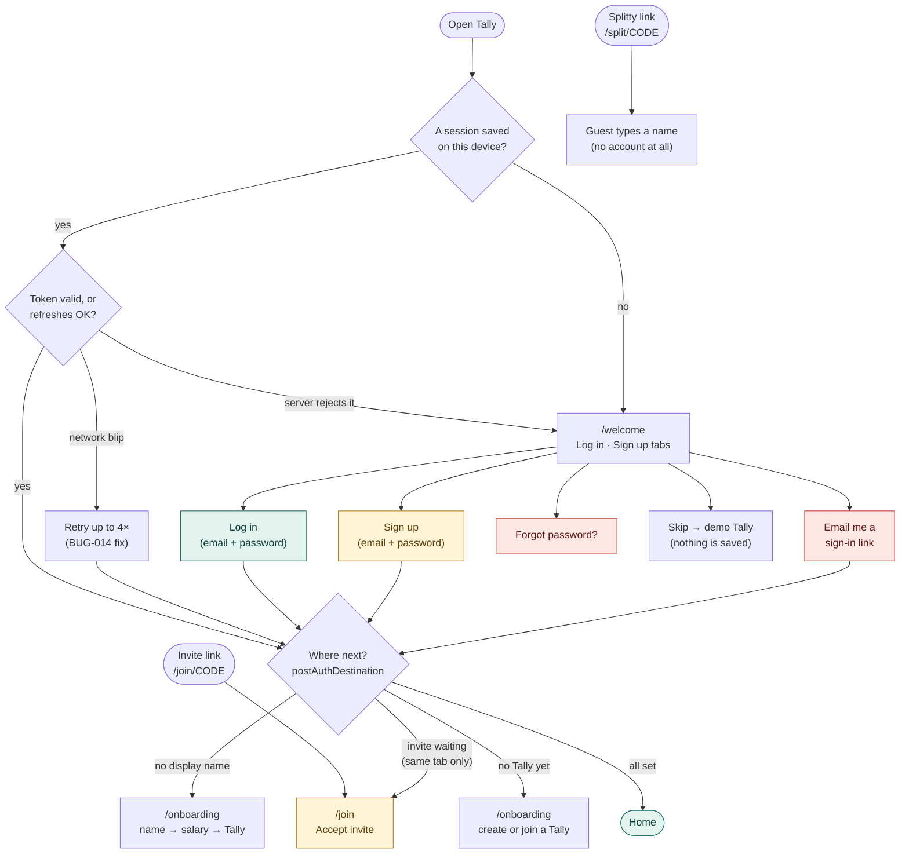

Two of the four buttons on the sign-in screen depend on email, and Tally can't
send email to its users (see 3 and 4).

### 2. Sign up

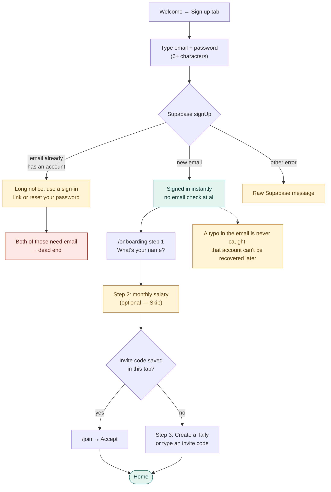

### 3. Log in, and "Forgot password?"

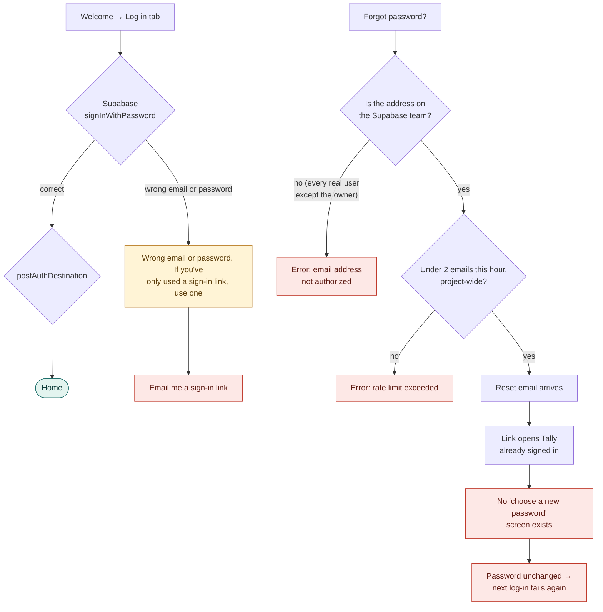

### 4. "Email me a sign-in link"

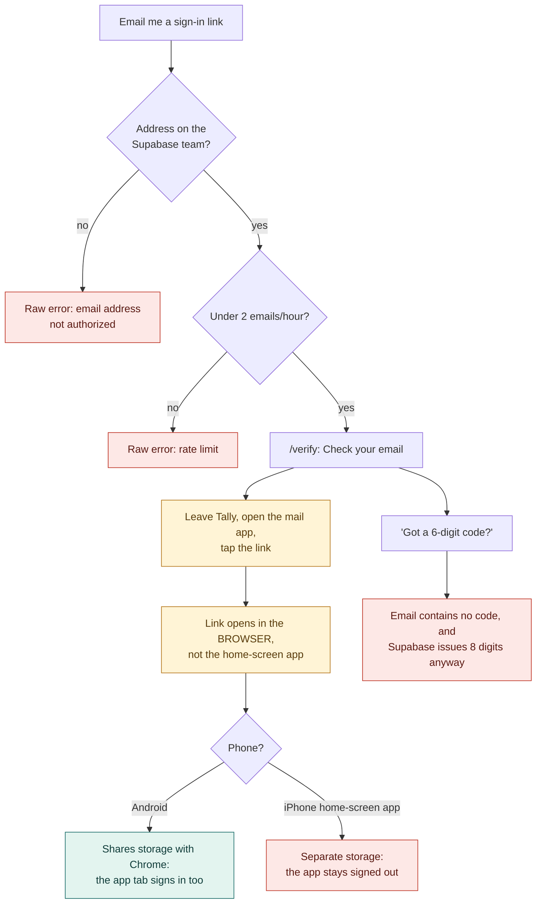

### 5. Joining someone's Tally by invite

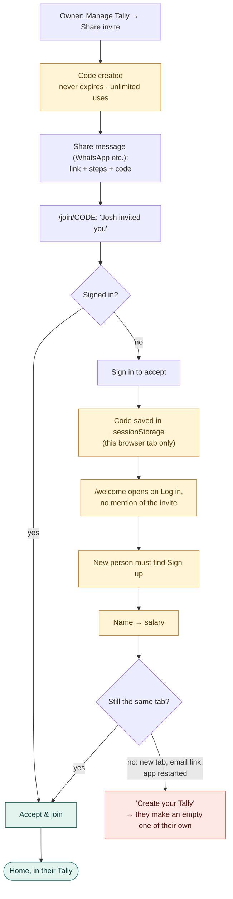

### 6. Opening the app, and signing out

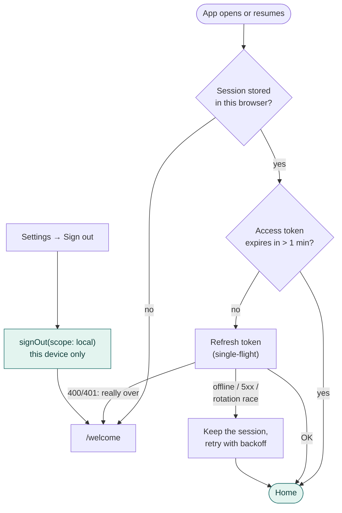

This part is solid since BUG-005, BUG-007 and BUG-014. Sessions last until a
refresh token is rejected; there's no idle timeout.

### 7. Splitty guests (no account)

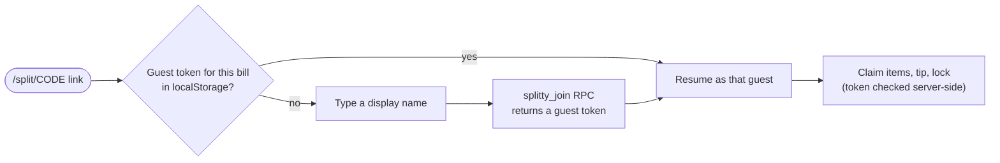

Separate by design (ADR-0013) and not part of the rework.

## Part 2 — How user records are stored

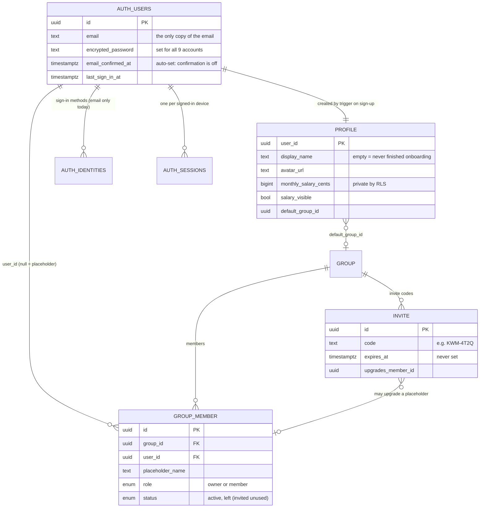

- **One identity per email.** `auth.users` is keyed on the email, so a
  password and a sign-in link on the same address are the same account. A
  second address is a second, unconnected account; there's no merge.
- **Email lives only in `auth.users`.** Co-members never see it, and nothing
  in the app shows you which address you're signed in with.
- **"Onboarded" is inferred** from a non-empty `display_name`. There's no
  explicit flag.
- **Live records (2026-10-28):** 9 accounts, all email + password. **4 are
  real people; 5 are leftover test accounts** from a 23 July verification
  run. Those 5 have no name, no expenses, and own 2 solo Tallies and 2
  invites. 6 invite codes exist; none expires.

## Part 3 — Proposed flows (after the rework)

### A. Getting in: one screen, one obvious path

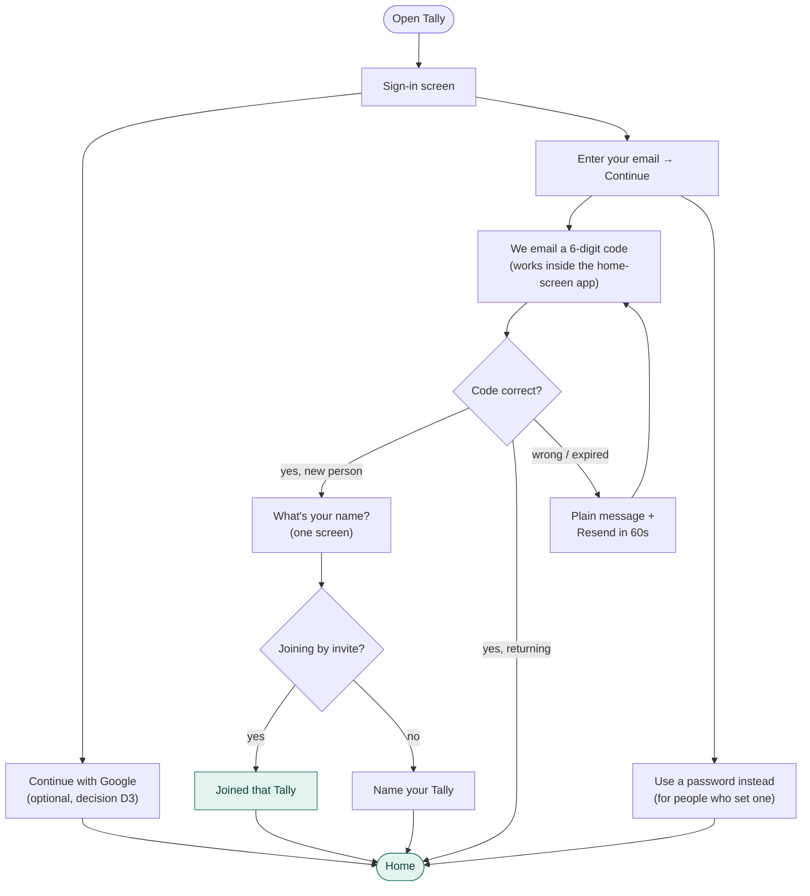

The same code flow covers sign-up, log-in, a new phone and a forgotten
password, so there's nothing separate to recover.

### B. Joining by invite

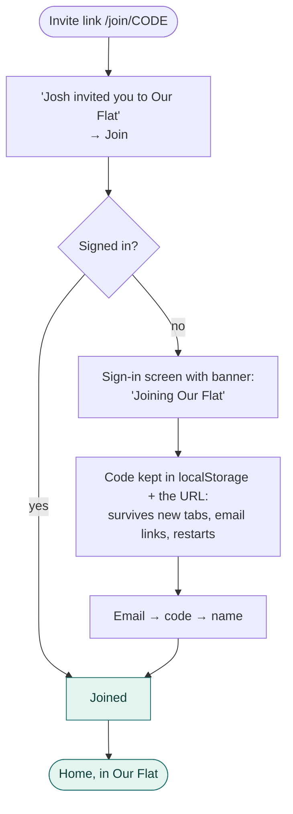

Invites expire after a set time and can be revoked. Salary is asked later, in
context (the first time someone picks a proportional split), not during
sign-up.

### C. Your account, in Settings

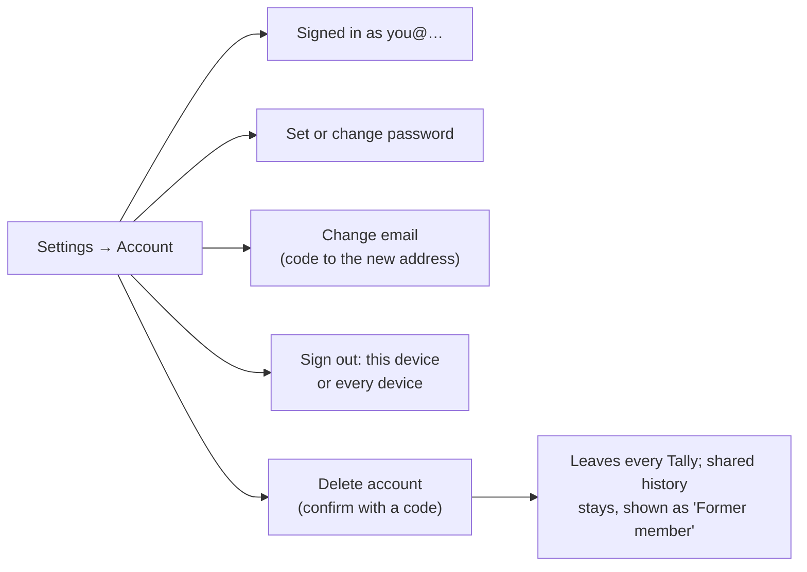
